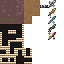
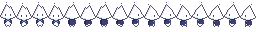
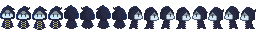
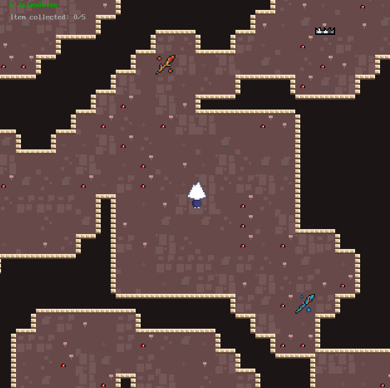

# S2 | Programmation & Synthèse d'image : IMAC Digger
> Par Guillaume Boucher, Nina Goislot et Paul Marchiset ☕︎☕︎☕︎

Bienvenue sur notre readme de notre jeu vidéo Phantom !

## Contrôles 

Phantom peut se joueur soit avec les touches <kbd>Z</kbd><kbd>Q</kbd><kbd>S</kbd><kbd>D</kbd> ou avec les flèches directionnelles <kbd>↑</kbd> <kbd>↓</kbd> <kbd>←</kbd> <kbd>→</kbd>. Utilisez les flèches directionnelles pour une experience focalisée : pas de déplacement en diagonal possible. Utilisez <kbd>Z</kbd><kbd>Q</kbd><kbd>S</kbd><kbd>D</kbd> pour explorer le jeu plus rapidement.

Pour miner les blocs, la touche est <kbd>A</kbd>.

Pour récupérer un item, c'est la touche <kbd>E</kbd>.

## Coup d'oeil sur le lore

Phantom est un jeu où nous incarnons une petite flamme partant dans une quête risquée. Un vieux sage à la tête triangle lui annonce qu’il a perdu sa vieille canne magique dans la cave du méchant vivant dans le grand manoir de la colline. Celle ci s'st cassée en plusieurs morceaux la dernière fois qu'il s'y ai aventuré et il aimerait la récupérer.

Le joueur se lance donc la recherche des morceaux perdus pour reconstruire la canne de M. PépéNG tout en se faisant pourchasser par l'hôte du manoir et plusieurs fantômes semblant hanter les lieux.

A la fin de son épopée la flamme toute contente part restituer les bouts de canne au vieux sage qui se révèle être un démon qui avait besoin de collecter les 5 morceaux de bâton magique pour conquérir le monde. Ne jamais se fier aux apparences. 

## Fonctionnalités

### Gestion des collisions

Notre joueur ne peut naturellement pas passer au travers des murs. Nous prenons les coordonnées du joueur et nous ne permettons le déplacement que si le futur bloc est une tuile de sol. Même si les detections de collisions sont censés fonctionner, nous avons implémenté une fonction de softlock qui redirige le joueur vers le haut si il se retrouvait coincé. 

### Minage

Notre joueur ne peut creuser que si les cases en face de lui sont des murs. Il peut le faire à l'aide de la touche <kbd>A</kbd>. 

### Items

Pour pouvoir gagner le jeu il est nécessaire de récupérer 5 items, qui sont des morceaux de cannes. Ces items sont placés de manière aléatoire sur les cases libres de la carte. Au bout du cinquième morceau de canne, le joueur "gagne" et est conduit à la scène de victoire. 

## Architecture 
### Organisation des fichiers

Le projet est décomposé en 5 parties de code : 

**1 - Les managers**

    Regroupent les fichiers en charge de toute une partie du code. Un gestionnaire de scene, du jeu, des textures, ect. 
## Génération de carte 

### Cases incassables

Les cases incassables sont générées aléatoirement et sont placés sur la carte sur les cases libres. Les rochers suivent les même système de collision que pour les murs, cependant ils ne peuvent être creusés.

### Pièges

Comme les roches et les items, les pièges sont placés de manière aléatoire sur les cases libres. Si le joueur entre en collision avec ceux-ci 

## Flow Field 

## Texturing 

Pour gérer le texturing de tous nos éléments nous avons créé un tileset qui regroupe tous les éléments de la carte. Nous avons également d'autres stylesheet pour le joueur et les ennemis.

| Texture atlas de la carte  |
| :---------------: |
|  | 

## IHM 

Notre jeu vidéo possède un écran d'accueil ainsi qu'un écran de victoire ou de perte du jeu. Durant la phase de jeu, le joueur peut consulter le nombre de vies qu'il possède encore ainsi que le nombre d'objets qu'il doit encore obtenir.

## Améliorations 

### Vies

Notre joueur possède plusieurs vies, au nombre de 3, si le joueur tombe dans un piège il perd une vie, s'il perd toutes ses vies, le joueur a perdu et est conduit à la scène de fin du jeu. Après une perte d'une vie, le joueur possède un temps d'invisibilité avant le prochain coup de dégât.

### Autotiling

Pour obtenir un autotiling autour des murs de la map, nous avons utilisé une fonction de bitmasking qui permet de stocker si les voisins de la tuile en question sont en vie ou non, respectivement si le north, west,east et south sont vivants ou non. Avec ceci nous appliquons un changement d'uv pour chaque cas sur la même texture pour détourer les murs. En ce qui concerne les améliorations possibles, nous avons remarqué que l'autotiling pouvait provoquer une chute des performances, il serait bon de passer plus de temps là dessus pour optimiser l'ensemble. Une autre amélioration pourrait être le fait d'ajouter de l'aléatoire pour que l'on reconnaisse moins de motif au sol notamment. 

### Animation

Notre joueur possède également une petite animation à l'aide d'un spritesheet avec une animation pour chaque direction. Si la flèche du haut est appuyée par exemple l'animation pour aller vers le haut est déclenchée et la frame change en fonction d'un certain temps donné que l'on compare au deltatime de la dernière frame et qui cycle pour ne correspondre uniquement à la direction donnée. Pour réaliser cela nous avons implémenter une petite fonction qui permet de mettre à jour les UVs d'une texture pour qu'il puisse passer d'une frame à une autre. Une petite amélioration à trouver à ceci serait le fait de garder la direction précédente du joueur en mémoire pour que s'il s'arrête d'avancer, la première frame du cycle soit sélectionnée. Nous pourrions également ajouter une animation d'idle.

| SpriteSheet du player  |
| :---------------: |
|  | 

| SpriteSheet du villain  |
| :---------------: |
|  |

### Améliorations abandonnées 

Une autre amélioration envisagée a été celle de la génération aléatoire de tuiles de sol. Cependant comme pour cela nous avions prévu de stocker un id aléatoire pour chaque tuile de la carte que nous utilisons pour définir la tuile de sol à  affecter. Le problème étant que dans ce cas nous vérifions l'id de chaque tuile dans une carte de 100x100 et donc de 10000 vérifications au minimum, l'execution du programme était donc très ralentie. Nous avons pas trouvé de solutions dans les temps donnés, nous avons donc préféré enlever cette fonctionnalité.

| SpriteSheet du player  |
| :---------------: |
|  |

## Difficultés 

En ce qui concerne les difficultés il y en a eu un certain nombre en effet, les principales difficultés se sont concentrées autour de l'architecture du code, de la gestion des textures et de la fiabilité du programme.

Il a été notamment très difficile de faire apparaître des textures sur les différents meshes au départ et une bonne partie du déboguage a été porté là dessus. Particulièrement en ce qui concerne les UVs et le découpage des tilesets. L'aide du renderDoc ainsi que de nos professeurs a été particulièrement utile.

### Problème de compilateur

Un problème assez étrange qui s'est produit également est le fait que pendant un certain temps il a été impossible de charger une texture avec stbi_load, en effet avec le compilateur Clang cette fonction nécessaire pour afficher des textures faisait planter l'application. Après un certain temps de déboguage nous avons réalisé qu'en changeant de compilateur pour GCC par exemple tout fonctionnait comme prévu.

> Tous les éléments graphiques utilisés dans ce projet ont été soit réalisés par nos soins ou sont libre de droit.